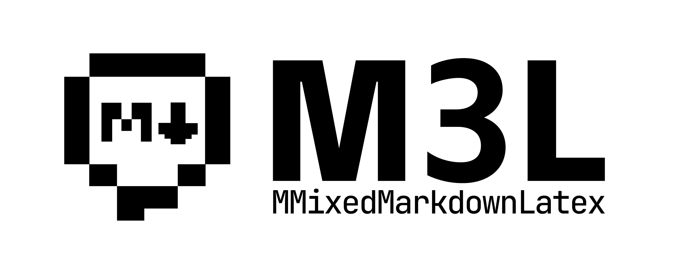

<div align="center">



</div>

M3L 是一个基于组合优于继承原则设计的，面向 Android Jetpack Compose 的渐进式富文本渲染库，它从 [MChat](https://github.com/MChat-code/MChat) 抽离而来，支持渲染并混排 Markdown、LaTeX、代码块、表格等内容，提供主题与组件级组合配置、单块样式覆盖、代码高亮、流式渲染和原生扩展能力。

**语言：** 简体中文 | [English](README.en.md)


[](https://jitpack.io/#M-Foundry/MMixedMarkdownLatex)

## ✨ 特性

- Markdown、表格、引用、分隔线、任务列表与基础 HTML
- 行内与块级 LaTeX 公式，包含化学公式等扩展
- TextMate 代码语法高亮、语言标签、行号和横向滚动
- 支持流式文本，暂缓显示未闭合公式、代码块和表格
- 使用渐进式 API 设计，提供从 `Markdown(content = ...)` 快速使用，按需增加样式、组件和行为配置的能力
- `MarkdownTheme` 统一注入主题、组件、链接处理和代码块工具栏
- 按组合优于继承原则设计，通过样式对象、插槽、单块覆盖和自定义渲染扩展能力
- 渲染外观、宿主行为和原生扩展分别提供独立入口

## 🚀 快速开始

### 从 JitPack 使用

项目已配置为可由 JitPack 构建。目标项目在 `settings.gradle.kts` 中加入：

```kotlin
dependencyResolutionManagement {
    repositories {
        google()
        mavenCentral()
        maven { url = uri("https://jitpack.io") }
    }
}
```

然后在模块的 `build.gradle.kts` 中加入：

```kotlin
dependencies {
    implementation("com.github.M-Foundry:MMixedMarkdownLatex:1.1.0")
}
```

## 📖 基本用法

```kotlin
import androidx.compose.runtime.Composable
import com.mroldl001.m3l.*

@Composable
fun RendererScreen(text: String, streaming: Boolean) {
    Markdown(
        content = text,
        isStreaming = streaming
    )
}
```

`content` 可以直接是 Markdown 字符串。渲染器会识别 Markdown、表格、引用、任务列表、基础 HTML、代码围栏和 LaTeX；渲染结果本身是一个填满父容器宽度的 `Column`，请将它放入宿主的 `LazyColumn`、`Column.verticalScroll` 或其他滚动容器中。

只需要解析内容时，可调用 `parseMarkdownBlocks(content)` 获取 `List<MarkdownBlock>`，块类型为 `MarkdownBlockType`。可选参数 `allowUnclosedCodeFence` 默认为 false。

使用 `MarkdownTheme` 统一提供颜色、样式、组件、代码块明暗色、链接事件和代码块工具栏。未传入的配置继承父级；高级用法仍可直接提供对应的 CompositionLocal。库不读取 `MaterialTheme`，页面滚动由宿主管理：

```kotlin
LazyColumn {
    item {
        MarkdownTheme(
            colors = MarkdownColors(
                primary = Color(0xFF6750A4),
                text = if (isSystemInDarkTheme()) Color.White else Color.Black,
                surface = Color.White,
                outlineVariant = Color(0xFFCAC4D0)
            ),
            darkCodeBlocks = isSystemInDarkTheme(),
            onLinkClick = { url -> openLink(url) }
        ) {
            Markdown(content = markdown)
        }
    }
}
```

### LaTeX 与表格

行内公式使用 `$...$` 或 `\\(...\\)`，块级公式使用独占一行的 `$$...$$` 或 `\\[...\\]`。公式会在后台生成 Bitmap，并按文字颜色、字号和显示模式缓存；首次生成前会暂时显示等宽文本，解析失败时也会保留可读的原文。超宽公式和表格可横向滚动。

```markdown
费马定理：$a^n + b^n = c^n$

$$
\\int_0^1 x^2 dx = \\frac{1}{3}
$$

| 名称 | 值 |
| --- | ---: |
| alpha | 1 |
```

避免在行内公式中使用未配对的 `$`；反引号代码中的 `$` 不会被当作公式。表格单元格中的公式也会参与宽度测量，内容过宽时由表格自身横向滚动。

向 `Markdown` 传入 `onFormulaWidthMeasured = { widthDp -> ... }` 可获取公式宽度，回调参数单位为 dp。

### 流式文本

接收模型输出时将 `isStreaming` 设为 `true`，结束后切换为 `false`：

```kotlin
Markdown(
    content = partialResponse,
    color = Color.Black,
    isStreaming = responseIsRunning
)
```

流式期间渲染器会暂缓未闭合的 LaTeX、代码围栏和表格，内部每约 80 ms 更新一次稳定文本；这样不会因为模型尚未输出结束分隔符而反复创建错误的中间布局。停止流式后会立即使用完整文本。宿主仍应使用稳定的 `key`，避免在列表中频繁销毁该 Composable。

## 🪡 宿主交互与行为

通过 `MarkdownTheme.codeBlockHeader` 提供代码块工具栏，也可直接提供 `LocalCodeBlockHeader`：

```kotlin
MarkdownTheme(
    codeBlockHeader = { block ->
        Row {
            BasicText(block.label)
            BasicText("复制", Modifier.clickable { onCopy(block.code) })
            BasicText("全屏", Modifier.clickable { onFullscreen(block) })
        }
    }
) {
    Markdown(content = text, color = Color.Black)
}
```

`CodeBlockContent` 提供原始代码、语言、已高亮行、配色和代码块位置；全屏页面可复用 `CodeBlockBody`。

代码围栏的语言标签会做常见别名归一化，例如 `py`→`python`、`js`→`javascript`、`kt`→`kotlin`、`sh`→`shellscript`。TextMate grammar 可使用库内资源或通过下文的 `grammarProvider` 提供；没有对应 grammar 时仍显示代码、行号和横向滚动。工具栏回调可以读取 `block.code`、`block.language` 和 `block.boundsInWindow()`，复制、全屏和图标行为由宿主实现。

链接点击可直接传给当前渲染器；通过 `MarkdownTheme.onLinkClick` 可为整个子树设置默认行为：

```kotlin
Markdown(content = content, onLinkClick = { url -> openLink(url) })
```

剪贴板、通知、全屏界面、返回手势和外部链接 Intent 均由宿主负责。

## 🧩 样式与组件扩展

本节只介绍渲染外观和组件替换；链接跳转、复制、全屏、剪贴板和通知等宿主行为见上节。

`Markdown(content = ...)` 只需要传入内容。`modifier` 控制外层布局；`style` 与 `components` 默认读取 `MarkdownTheme` 注入的配置；`onLinkClick` 可直接处理当前渲染器的链接。正文颜色优先级为 `style.body.color`、入口参数 `color`、`MarkdownColors.text`；默认是黑色。`Color.Unspecified` 表示继承默认值。

以下示例关闭链接下划线、覆盖行内代码和表格颜色，并独立设置原生选择手柄颜色：

```kotlin
val style = MarkdownStyle(
    body = TextStyle(fontSize = 16.sp, lineHeight = 25.sp),
    headings = mapOf(2 to TextStyle(fontSize = 24.sp, fontWeight = FontWeight.Bold)),
    link = MarkdownLinkStyle(color = Color(0xFF1565C0), underline = false),
    inlineCode = MarkdownInlineCodeStyle(
        color = Color(0xFFC62828),
        backgroundColor = Color(0xFFFFF3E0),
        cornerRadius = 6.dp
    ),
    selection = MarkdownSelectionStyle(
        handleColor = Color(0xFF1565C0),
        backgroundColor = Color(0x331565C0)
    ),
    table = MarkdownTableStyle(
        headerBackground = Color(0xFFE3F2FD),
        alternateBackground = Color(0xFFF5F5F5),
        columnAlignments = mapOf(1 to TextAlign.End)
    )
)
Markdown(content = content, color = Color.Black, style = style)
```

示例中的类型来自 `com.mroldl001.m3l.*` 以及 Compose 的 `TextStyle`、`FontWeight`、`TextAlign`、`Color`、`dp`、`sp`。也可在父级通过 `CompositionLocalProvider(LocalMarkdownStyle provides style)` 注入；引用和表格单元格会继承配置。使用 `copy` 修改当前样式可保留其他设置；传入新的 `MarkdownStyle()` 会使用新对象的完整默认配置。

### 样式字段

| 类型                      | 字段与用途                                                                                                                                                                                                                                                                                                     |
| ------------------------- | -------------------------------------------------------------------------------------------------------------------------------------------------------------------------------------------------------------------------------------------------------------------------------------------------------------- |
| `MarkdownStyle`           | `body` 正文排版；`headings` 按标题级别 1–6 覆盖排版；`paragraphSpacing` 段间距；`listIndent` 列表缩进；`bulletColor`、`bulletWidth` 列表圆点；`streamingIntervalMillis` 流式刷新间隔，默认 80，必须大于 0                                                                                                      |
| `MarkdownStyle` 子配置    | `link`、`inlineCode`、`selection`、`codeBlock`、`quote`、`divider`、`table`、`latex`、`image`、`native`，字段如下                                                                                                                                                                                              |
| `MarkdownLinkStyle`       | `color`、`underline`、`textStyle: SpanStyle`；`autoLinkMask` 控制自动识别，默认网页和邮箱，设为 0 关闭自动识别；`icon: (String) -> Drawable?` 按链接地址提供行内图标，返回 null 不显示；`iconSize` 默认 16.dp，`iconGap` 默认 4.dp；`iconPlacement` 默认 `BeforeText`，可设为 `AfterText` 将图标放在链接文字后 |
| `MarkdownInlineCodeStyle` | `color`、`backgroundColor`、`cornerRadius`、`fontFamily`、`fontWeight`、`fontStyle`、`sizeScale`；默认等宽字体、4.dp 圆角、0.95 倍字号                                                                                                                                                                         |
| `MarkdownSelectionStyle`  | `enabled` 控制正文文本选择；`handleColor`、`backgroundColor` 独立覆盖手柄和选区颜色。未指定时跟随主题主色；原生选择手柄着色需要 Android API 29+                                                                                                                                                                |

#### 布局、表格与媒体样式

| 类型                            | 字段与用途                                                                                                                                                                                                                                                                                                                                                                                                                                        |
| ------------------------------- | ------------------------------------------------------------------------------------------------------------------------------------------------------------------------------------------------------------------------------------------------------------------------------------------------------------------------------------------------------------------------------------------------------------------------------------------------- |
| `MarkdownQuoteStyle`            | `barColor`、`backgroundColor`、`textColor`、`textStyle`；`barWidth`、`barShape` 控制竖线；`spacing` 控制竖线到正文的距离；`padding`、`contentPadding` 控制外部和内容间距                                                                                                                                                                                                                                                                          |
| `MarkdownDividerStyle`          | `color`、`thickness`、`shape`、`padding`                                                                                                                                                                                                                                                                                                                                                                                                          |
| `MarkdownTableStyle` 颜色与排版 | `borderColor`、`headerBackground`、`bodyBackground`、`alternateBackground`、`headerTextColor`、`bodyTextColor`、`headerTextStyle`、`bodyTextStyle`                                                                                                                                                                                                                                                                                                |
| `MarkdownTableStyle` 布局       | `borderWidth`、`cellBorderWidth`、`shape`、`padding`、`cellPadding`；`minColumnWidth`、`maxColumnWidth` 限制自动列宽；`columnWidths` 按 0 起始列索引指定列宽，未指定的列自动测量；`columnAlignments` 按列覆盖文字对齐；`cellAlignment` 主要控制内容竖直位置，正文占满列宽，横向文字由 `columnAlignments` 或 `TextStyle.textAlign` 决定；`respectMarkdownAlignment` 默认 false，开启后读取 Markdown 分隔行的冒号对齐，显式 `columnAlignments` 优先 |
| `MarkdownImageStyle`            | `width`、`height`、`cornerRadius`；`loadingDrawable`、`failureDrawable` 提供原生占位图；`onClick` 接收图片地址；`imageLoader` 注入 Coil `ImageLoader`；`configureRequest` 接收 `ImageRequest.Builder` 和地址，配置请求；`onClickWithContext` 接收图片位置和 `TextView`；`verticalOffsetPx` 按图片位置返回绘制时的纵向位移像素；`motionPadding` 为位移动画预留上下空间                                                                             |

### 代码块与高亮

| `MarkdownCodeBlockStyle` 字段                                                | 用途                                                                                                                                                                   |
| ---------------------------------------------------------------------------- | ---------------------------------------------------------------------------------------------------------------------------------------------------------------------- |
| `palette`                                                                    | 覆盖整个 `CodeBlockPalette`，未指定时使用 `LocalCodeBlockDark` 和主题色生成的配色                                                                                      |
| `textStyle`、`lineNumberStyle`                                               | 分别设置代码和行号排版；独立测量并按每行基线对齐，支持中文回退字体                                                                                                     |
| `showLineNumbers`、`lineNumberGutter`                                        | 行号显隐和行号到代码的距离                                                                                                                                             |
| `shape`、`contentPadding`、`verticalPadding`                                 | 容器形状、正文内边距、代码块上下间距                                                                                                                                   |
| `headerTextStyle`、`headerPadding`、`emptyHeaderHeight`、`showLanguageLabel` | 默认语言标签排版与间距；注入 `LocalCodeBlockHeader` 后由宿主管理头部                                                                                                   |
| `scrollbarColor`、`showHorizontalBar`                                        | 横向滚动条颜色和显隐                                                                                                                                                   |
| `languageAliases`                                                            | 语言别名映射，优先于内置映射                                                                                                                                           |
| `grammarProvider`                                                            | `(Context, String) -> String?`，按规范化语言名或引用的 scope 名返回 TextMate JSON，返回 null 回退库内 grammar                                                          |
| `highlightRules`                                                             | `List<MarkdownHighlightRule>`；每条规则包含 `scopes` 和 `style: SpanStyle`，匹配完全相同或以 `scope.` 开头的 token scope；按列表顺序合并，后面的规则覆盖前面的同名属性 |
| `highlighter`                                                                | `MarkdownCodeHighlighter`，签名为 `suspend (List<String>, String?) -> List<AnnotatedString>`，在后台替换整个高亮流程                                                   |

`CodeBlockPalette` 开放 `background`、`text`、`muted`、`keyword`、`string`、`number`、`comment`、`type`、`function`、`operator`、`annotation`、`property`。`codeBlockPalette(dark, primaryTint)` 是 Composable，可生成基础配色后用 `copy` 覆盖部分颜色：

```kotlin
val palette = codeBlockPalette(dark = false, primaryTint = Color(0xFF1565C0))
val style = LocalMarkdownStyle.current.let { current ->
    current.copy(
        codeBlock = current.codeBlock.copy(
            palette = palette.copy(keyword = Color(0xFFAD1457)),
            showLineNumbers = false,
            languageAliases = mapOf("custom-kotlin" to "kotlin"),
            highlightRules = listOf(
                MarkdownHighlightRule(
                    scopes = listOf("comment"),
                    style = SpanStyle(color = Color(0xFF607D8B), fontStyle = FontStyle.Italic)
                )
            )
        )
    )
}
```

自定义 `highlighter` 必须保持输入行数和每行原文；异常或结果改变原文时回退为未着色文本。`CodeBlockBody` 还可直接传入 `textStyle`、`lineNumberStyle`、`showLineNumbers`、`lineNumberGutter`、`scrollbarColor`、`showHorizontalBar`、`fillHeight`、`modifier`，供宿主全屏界面复用。

### 公式

`MarkdownLatexStyle` 提供 `inlineColor`、`blockColor`、`inlineFontSize`、`blockFontSize`；字号默认 18.sp，必须为正的有限 sp 值。`transform` 可在渲染前转换公式字符串，行内与块级公式共用。

块级公式另有 `blockAlignment`、`blockPadding`、`fallbackStyle`、`loading`、`error`、`onClick`、`contentDescription`。`loading` 和 `error` 是接收公式原文的 Compose 插槽，`onClick` 接收原文，`contentDescription` 返回无障碍描述。`blockPadding = null` 保留按公式高度自动计算的间距；`compact` 模式默认移除这部分间距。行内公式加载中或失败时保留原文。

### 注入图标、操作、组件替换与单块覆盖

`MarkdownComponents` 对解析出的块提供以下接口：

| 字段                  | 行为                                                                                                                                     |
| --------------------- | ---------------------------------------------------------------------------------------------------------------------------------------- |
| `leading`、`trailing` | `MarkdownBlockSlot`，分别显示在默认或替换内容的前后，与内容横向排列，可注入 Compose 图标                                                 |
| `actions`             | `MarkdownBlockSlot`，显示在整行下方，可注入复制按钮等操作                                                                                |
| `blocks`              | 按 `MarkdownBlockType` 注册 `MarkdownBlockRenderer`，接收块上下文及 `defaultContent`；可完全替换，或调用 `defaultContent()` 装饰内建组件 |
| `resolveStyle`        | 接收继承样式所在的 `MarkdownBlockContext`，返回当前块的完整 `MarkdownStyle`；用 `context.style.copy(...)` 做局部覆盖                     |
| `modifier`            | 接收解析后的上下文，为整块提供 `Modifier`                                                                                                |

`MarkdownBlockContext` 包含 `block`（`type`、`content`、`info`）、同级 0 起始 `index`、`path`、`depth`、`style`。插槽、组件渲染器和 `modifier` 看到的是 `resolveStyle` 处理后的样式。`path` 从顶层块索引开始；引用内追加块索引，表格单元格追加行、列索引后再追加块索引，表头行索引为 0；`depth = path.size - 1`，包含表格坐标。路径随解析结构变化，不是跨编辑稳定 ID。

```kotlin
val decorateFormula: MarkdownBlockRenderer = { _, defaultContent ->
    Column(Modifier.background(Color(0xFFF5F5F5))) {
        defaultContent()
    }
}
val components = MarkdownComponents(
    leading = { context ->
        if (context.block.type == MarkdownBlockType.QUOTE) {
            Image(painter = quoteIcon, contentDescription = null, modifier = Modifier.size(16.dp))
        }
    },
    actions = { context ->
        if (context.block.type == MarkdownBlockType.CODE_BLOCK) {
            BasicText("复制", Modifier.clickable { copyCode(context.block.content) })
        }
    },
    blocks = mapOf(MarkdownBlockType.LATEX_BLOCK to decorateFormula),
    resolveStyle = { context ->
        if (context.block.type == MarkdownBlockType.QUOTE) {
            context.style.copy(quote = context.style.quote.copy(barColor = Color(0xFF1565C0)))
        } else {
            context.style
        }
    }
)
Markdown(
    content = content,
    color = Color.Black,
    components = components
)
```

`quoteIcon: Painter` 与 `copyCode` 由宿主提供。`defaultContent` 直接调用当前块的内建渲染；嵌套引用、表格中的子块仍应用继承的组件配置。`MarkdownBlockType` 包括 `MARKDOWN`、`TABLE`、`CODE_BLOCK`、`INLINE_CODE`、`LATEX_INLINE`、`LATEX_BLOCK`、`QUOTE`、`HR`；普通段落中的行内链接、代码和公式随 Markdown 正文渲染，分别使用对应样式配置。可通过 `CompositionLocalProvider(LocalMarkdownComponents provides components)` 给整个子树设置插槽。

### 原生扩展

链接行内图标使用 Android `Drawable`，图片占位图也使用 `Drawable`；块级图标、加载状态和操作区使用 Compose 内容。`MarkdownImageStyle.imageLoader` 可复用宿主已有的 Coil 加载器，`configureRequest` 可设置请求头、缓存策略等 Coil 请求选项。自定义图片加载器的生命周期由宿主管理。

`MarkdownNativeConfiguration` 提供 `configureMarkwon`、`transformSpans` 和 `configureTextView` 三个钩子。前者在内置插件注册后、构建 Markwon 前执行；`transformSpans` 在公式、标题、链接、图片和行内代码样式处理后执行；后者在视图样式和渲染文本设置后执行，可进一步覆盖原生视图配置。原生钩子可能在重组或样式变化时再次执行，应保持可重复调用。Markwon、Coil 类型随库的公开 API 暴露，宿主不需要依赖 Material 组件。

## 🤝 开发与贡献

贡献者请参阅[贡献指南](CONTRIBUTING.md)，其中包含开发环境、本地验证和发行包说明。

## 📄 许可证

本项目使用 Apache-2.0 许可证，详见根目录 `LICENSE`
